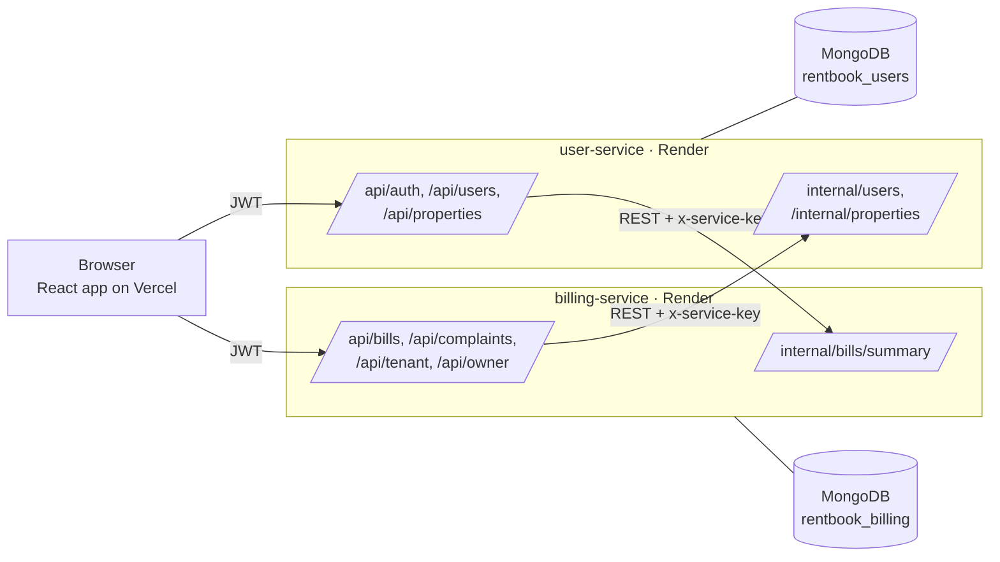

# RentBook — Microservices-Based PG & Rental Management

**22MDC55 Full Stack Application Development Lab — CAT-II Mini Project**
Coimbatore Institute of Technology · M.Sc. Decision and Computing Sciences · Semester V

> Team: _<name / roll no.>_ · _<name / roll no.>_ · _<name / roll no.>_

RentBook replaces the paper register used by PG and rental owners. Owners manage properties, issue monthly bills (rent + electricity + water + internet) and handle repair requests. Tenants see what they owe and when it is due, pay bills, and raise maintenance complaints.

The application is built as **three independently deployable microservices** with **separate databases** that communicate **over REST**, plus a React frontend. A Telegram bot pushes alerts to owners and tenants (see [docs/TELEGRAM_SETUP.md](docs/TELEGRAM_SETUP.md)).

## Deployment links

| Component | URL |
|---|---|
| Frontend (Vercel) | `https://<your-app>.vercel.app` |
| user-service (Render) | `https://<your-user-service>.onrender.com/api/health` |
| billing-service (Render) | `https://<your-billing-service>.onrender.com/api/health` |
| notification-service (Render) | `https://<your-notification-service>.onrender.com/api/health` |
| Live service-to-service check | `https://<your-app>.vercel.app/status` |
| Source code | `https://github.com/<you>/rentbook` |

Demo logins (after running the seed script): `owner@rentbook.in` / `123456`, `tenant@rentbook.in` / `123456`.

---

## How this project meets the evaluation criteria

| Criterion (marks) | Where it is in RentBook |
|---|---|
| **1. Backend (10)** | Two services, each with its own REST API, MongoDB database and CRUD: properties (C-R-U-D), bills (C-R-U-D + pay), complaints (C-R-U-D), users (register/login/me/tenants). Mongoose validation, JWT auth, role-based access. |
| **2. Microservice communication (5)** | 7 internal REST endpoints. billing-service → user-service to validate tenants/properties and attach names; user-service → billing-service before deleting a property. Shared service key, timeouts, retry, request-id tracing, graceful degradation (see [Inter-service communication](#inter-service-communication)). |
| **3. Frontend (5)** | React 19 + Vite + Tailwind, 11 pages, separate API client per service, loading/error/retry states, degraded-mode banner, role-based routing. |
| **4. Deployment (5)** | Each service deployed independently on Render (`render.yaml`), frontend on Vercel (`vercel.json`), `/status` page proves both services and both directions of communication live. |
| **5. Testing & docs (5)** | Postman collection: 55 requests, 87 assertions, all passing. This README, [API reference](docs/API_REFERENCE.md), [deployment guide](docs/DEPLOYMENT.md), [project report](docs/PROJECT_REPORT.md), [viva & demo notes](docs/VIVA_AND_DEMO.md). |

---

## Architecture



| Service | Owns | Database | Calls |
|---|---|---|---|
| **user-service** (5001) | Users, authentication (JWT issuing), properties | `rentbook_users` | billing-service |
| **billing-service** (5002) | Bills, payments, complaints, dashboards | `rentbook_billing` | user-service, notification-service |
| **notification-service** (5003) | Telegram alerts, in-app notification feed, daily reminders | `rentbook_notifications` | user-service, billing-service |
| **client** (3000) | React UI | — | both services directly |

**Database per service.** Each service can only read and write its own database. Data owned by the other service is fetched through its API, never through a shared database. Because of this, Mongoose `populate()` cannot cross the boundary: billing-service stores tenant/property **ids** and resolves names via REST.

**Stateless authentication.** user-service signs a JWT containing `{ id, role }`. billing-service verifies the same token with the shared `JWT_SECRET`, so it can authorise requests without a database lookup or a network call.

### Inter-service communication

| # | Caller → callee | Endpoint | When | If the callee is down |
|---|---|---|---|---|
| 1 | billing → user | `GET /internal/users/:id` | Issuing a bill: is the tenant real and a tenant? | 503, bill not created (fail safe) |
| 2 | billing → user | `GET /internal/properties/:id` | Issuing a bill: does the property belong to this owner? Tenant dashboard: property name | 503 for bills; dashboard shows placeholder |
| 3 | billing → user | `POST /internal/users/batch` | Listing bills/complaints: attach tenant names in **one** call | List still returned, names marked unavailable, `x-degraded` header |
| 4 | billing → user | `POST /internal/properties/batch` | Listing bills/complaints: attach property names | Same as above |
| 5 | billing → user | `GET /internal/properties?owner=` | Owner dashboard: rooms, occupancy, expected income | Payment figures still returned, occupancy `null` |
| 6 | user → billing | `GET /internal/bills/summary?property=` | Deleting a property: any unpaid bills? | 503, property not deleted (fail safe) |
| 7 | billing → notify | `POST /internal/events` | After a bill is issued/paid or a complaint changes | Fire-and-forget: the bill/complaint is still saved |
| 8 | notify → billing | `GET /internal/digest` | Daily reminders: unpaid, due soon, repairs waiting | Digest skipped, retried next run |
| 9 | notify → user | `GET /internal/users/:id` | Name for the Telegram greeting | Generic name used |
| 10 | all | `GET /api/health/dependencies` | Status page: can each service reach the others? | Reports `reachable: false` |

All calls go through `utils/serviceClient.js` in each service, which adds the `x-service-key` and `x-request-id` headers, applies a timeout (`SERVICE_TIMEOUT_MS`, default 20 s), retries read calls once, and converts network failures into clean `502/503` JSON errors. Internal routes reject any caller without the correct key (`403`).

---

## Project structure

```
RentBook/
├── user-service/            # Microservice 1
│   ├── config/db.js
│   ├── controllers/         # auth, user, property, internal, health
│   ├── middleware/          # authMiddleware, serviceAuth, requestLogger, errorHandler
│   ├── models/              # User, Property
│   ├── routes/
│   ├── utils/               # serviceClient, billingServiceClient, generateToken, ...
│   ├── server.js
│   └── .env.example
├── billing-service/         # Microservice 2
│   ├── controllers/         # bill, complaint, dashboard, internal, health
│   ├── middleware/
│   ├── models/              # Bill, Complaint
│   ├── routes/
│   ├── utils/               # serviceClient, userServiceClient, enrich, ...
│   ├── server.js
│   └── .env.example
├── client/                  # React frontend (Vite + Tailwind)
│   ├── src/api/client.js    # one axios client per microservice
│   ├── src/pages/           # 11 pages incl. ServiceStatus
│   ├── vercel.json
│   └── .env.example
├── docs/
│   ├── API_REFERENCE.md
│   ├── DEPLOYMENT.md
│   ├── PROJECT_REPORT.md
│   ├── VIVA_AND_DEMO.md
│   ├── postman/             # collection + Local/Deployed environments
│   └── screenshots/
├── scripts/seed-demo.mjs    # seeds demo data through the APIs
└── render.yaml              # Render blueprint for both services
```

---

## Run locally

Requirements: Node.js 18+, a MongoDB Atlas cluster (free tier is fine).

```bash
# 1. Environment files (fill in your Atlas URI and secrets)
cp user-service/.env.example    user-service/.env
cp billing-service/.env.example billing-service/.env
cp notification-service/.env.example notification-service/.env
#    JWT_SECRET and SERVICE_KEY must be identical in both files.

# 2. Install
cd user-service    && npm install && cd ..
cd billing-service && npm install && cd ..
cd notification-service && npm install && cd ..
cd client          && npm install && cd ..

# 3. Run (three terminals)
cd user-service    && npm run dev      # http://localhost:5001
cd billing-service && npm run dev      # http://localhost:5002
cd notification-service && npm run dev # http://localhost:5003
cd client          && npm run dev      # http://localhost:3000

# 4. Demo data (optional, any terminal)
node scripts/seed-demo.mjs
```

Open http://localhost:3000/status first: all four checks should be green.

In development the Vite dev server proxies `/user-api/*` to port 5001 and `/billing-api/*` to port 5002, so the browser talks to two separate backends exactly as in production.

---

## API overview

Full request/response details: **[docs/API_REFERENCE.md](docs/API_REFERENCE.md)**.

**user-service**

| Method | Endpoint | Access | Purpose |
|---|---|---|---|
| POST | `/api/auth/register` | public | Create account (tenant/owner), returns JWT |
| POST | `/api/auth/login` | public | Log in, returns JWT |
| GET | `/api/auth/me` | any user | Current user |
| GET | `/api/users/tenants` | owner | Tenant list for the bill form |
| GET / POST | `/api/properties` | owner | List / create properties |
| GET / PUT / DELETE | `/api/properties/:id` | owner | Read / update / delete (delete checks billing-service) |
| GET | `/api/health`, `/api/health/dependencies` | public | Health, reachability of billing-service |

**billing-service**

| Method | Endpoint | Access | Purpose |
|---|---|---|---|
| GET / POST | `/api/bills` | user / owner | List (own) / issue bill (validated via user-service) |
| GET / PUT / DELETE | `/api/bills/:id` | user / owner / owner | Read / edit pending / delete pending |
| POST | `/api/bills/:id/pay` | tenant | Pay a bill |
| GET / POST | `/api/complaints` | user / tenant | List (own) / raise complaint |
| PUT / DELETE | `/api/complaints/:id` | owner / tenant | Update status / withdraw pending |
| GET | `/api/tenant/summary` | tenant | Dashboard (property name via user-service) |
| GET | `/api/owner/stats` | owner | Dashboard combining both services |
| GET | `/api/health`, `/api/health/dependencies` | public | Health, reachability of user-service |

---

## Testing

Import `docs/postman/RentBook.postman_collection.json` and one of the environments in `docs/postman/` into Postman, set `serviceKey` to your `SERVICE_KEY`, then **Run collection**. Each run creates fresh accounts, so it can be repeated.

From the command line:

```bash
npx newman run docs/postman/RentBook.postman_collection.json \
  -e docs/postman/RentBook-Local.postman_environment.json \
  --env-var serviceKey=<your SERVICE_KEY>
```

Result on the final build: **73 requests, 118 assertions, 0 failures**. The suite covers happy paths, validation errors (400), auth (401/403), not-found (404), conflicts (409), the internal-key guard, and both directions of service-to-service communication.

---

## Tech stack

Node.js, Express 5, MongoDB Atlas, Mongoose, JWT, bcryptjs, axios · React 19, Vite, Tailwind CSS 4, React Router · Render (services), Vercel (frontend) · Postman / Newman.
