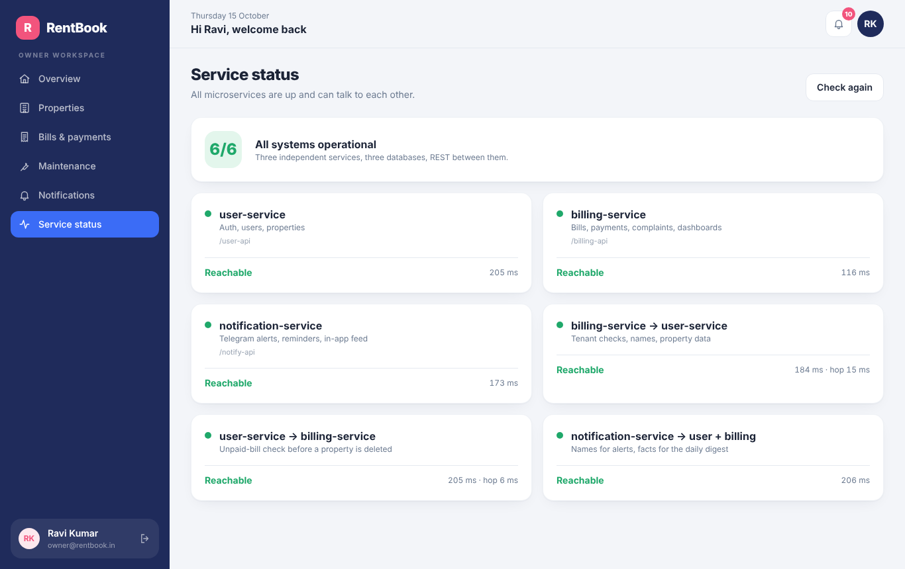
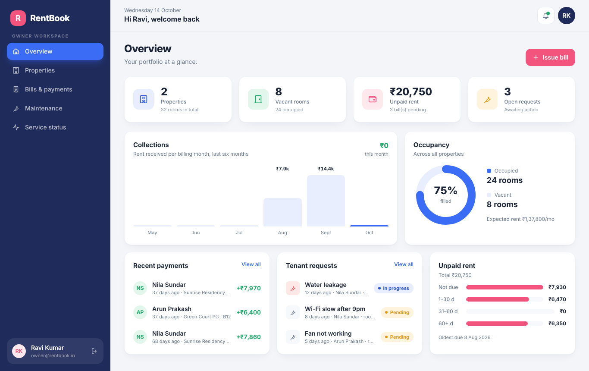

# Project Report: RentBook

**Development and Deployment of a Microservices-Based Full Stack Application**
22MDC55 Full Stack Application Development Lab · CAT-II · 15 October 2026
M.Sc. Decision and Computing Sciences, Coimbatore Institute of Technology

| Team member | Roll no. | Contribution |
|---|---|---|
| _<name>_ | _<roll>_ | _<e.g. user-service, deployment>_ |
| _<name>_ | _<roll>_ | _<e.g. billing-service, testing>_ |
| _<name>_ | _<roll>_ | _<e.g. frontend, documentation>_ |

---

## 1. Problem statement

Small PG (paying guest) and rental owners still track rooms, monthly bills and repair requests in paper registers or chat messages. Tenants rarely know their exact dues or due dates, utilities are calculated by hand, and complaints get lost. RentBook gives owners one place to manage properties, issue itemised monthly bills and handle repairs, and gives tenants a clear view of what they owe, a way to pay, and a way to report problems.

## 2. Objectives

1. Build the application as at least two independent microservices, each with its own REST API and database.
2. Make the services cooperate only through REST calls, with proper error handling.
3. Provide a React interface for two roles (owner, tenant) that consumes both services.
4. Deploy each service independently, plus the frontend, and prove they communicate in the cloud.
5. Test every API with Postman and document the system.

## 3. System architecture

| Component | Responsibility | Data | Hosting |
|---|---|---|---|
| user-service | Registration, login (JWT), users, properties | MongoDB `rentbook_users` | Render web service |
| billing-service | Bills, payments, complaints, dashboards | MongoDB `rentbook_billing` | Render web service |
| client | React single-page app for owners and tenants | — | Vercel |

**Decomposition rationale.** The split follows data ownership. Identity and properties change rarely and are needed by everything; bills and complaints are high-volume, transactional records. Each service owns its collections outright (database-per-service pattern), so either can be changed, scaled or redeployed without touching the other.

**Authentication across services.** user-service issues a JWT carrying the user's id and role. billing-service verifies the same token with a shared secret, so authorisation is stateless and needs no extra network call per request.

## 4. Data model

| Service | Collection | Key fields |
|---|---|---|
| user-service | `users` | name, email (unique), password (bcrypt hash), role (tenant/owner) |
| user-service | `properties` | name, address, rooms, occupied (≤ rooms), monthlyRent, owner |
| billing-service | `bills` | tenant, owner, property, room, month (YYYY-MM), rent, electricity, water, internet, status, dueDate, paidOn; virtual `total`; unique (tenant, month) |
| billing-service | `complaints` | tenant, owner, property, room, title, description, priority, status |

`tenant`, `owner` and `property` in billing-service are ids that belong to user-service. They are resolved over REST, not with database joins.

## 5. Inter-service communication

| Flow | Direction | Purpose |
|---|---|---|
| Issue bill | billing → user | Confirm the tenant exists and is a tenant; confirm the property belongs to the owner |
| List bills / complaints | billing → user | Batch-fetch tenant and property names (one call each, avoiding N+1 requests) |
| Owner dashboard | billing → user | Combine occupancy and expected income (user-service) with collections and dues (billing-service) |
| Tenant dashboard | billing → user | Property name for the tenant's current residence |
| Delete property | user → billing | Refuse deletion while unpaid bills exist |
| Health dependencies | both | Prove each deployed service can reach the other |

**Reliability measures.** A shared `x-service-key` header guards all `/internal` routes. Every call has a timeout and read calls are retried once (useful when a free-tier service is waking). Network failures become clean `503` responses instead of crashes. Writes that depend on the other service fail safe (no bill without a verified tenant, no property deletion without the bill check). Reads degrade gracefully: if user-service is down, bills still load with placeholder names and the UI shows a banner. A request id travels with each call so one user action can be traced through both services' logs.

## 6. Frontend

React 19 with Vite, Tailwind CSS and React Router. Auth state is shared through the Context API; routes are guarded by role. `src/api/client.js` holds one axios client per microservice, with interceptors that attach the JWT, sign the user out on an expired token, surface degraded responses and turn network errors into readable messages. Every page has loading, error and retry states.

| Owner | Tenant | Public |
|---|---|---|
| Dashboard (occupancy, dues, collections chart), Properties (CRUD), Bills (issue, edit, delete), Maintenance queue | Dashboard (amount due, due-date strip), Bills & payments (filter, pay), Maintenance (raise, track, withdraw) | Login, Register, Service status |

## 7. Security

Passwords hashed with bcrypt; JWT expiry of 7 days; role checks on the server for every protected route (the client-side guard is only for convenience); ownership checks so users can only touch their own records; whitelisted update fields so a request cannot reassign a property's owner; admin role cannot be self-assigned at sign-up; internal routes protected by a service key; secrets kept in environment variables, never committed.

## 8. Testing

A Postman collection of **55 requests in 7 folders** with **87 automated assertions** covers health and connectivity, authentication, property CRUD, bills, complaints, dashboards and the internal APIs. It checks successful flows and error cases (400, 401, 403, 404, 409), confirms names arrive from the other service, and verifies both directions of communication (bill creation validated by user-service; property deletion blocked by billing-service).

| Run | Requests | Assertions | Failed |
|---|---|---|---|
| Local (both services) | 55 | 87 | 0 |
| Deployed (Render) | _fill in_ | _fill in_ | _fill in_ |

A failure test was also run by stopping user-service: billing-service kept serving bills with placeholder names (`x-degraded` header), refused to create new bills with a clear `503`, and its dependency check reported `reachable: false`.

## 9. Deployment

| Component | Platform | URL |
|---|---|---|
| user-service | Render | _https://…onrender.com_ |
| billing-service | Render | _https://…onrender.com_ |
| Frontend | Vercel | _https://…vercel.app_ |

Each service is a separate Render web service with its own root directory, build, environment variables and health check, so either can be redeployed alone. The frontend reads both service URLs from build-time environment variables. Full steps: `docs/DEPLOYMENT.md`.

## 10. Conclusion and future scope

RentBook meets every requirement of the brief: two independently deployed microservices with separate databases, full CRUD, REST-based communication in both directions with security and failure handling, a role-based React frontend, cloud deployment, and an automated API test suite.

Future work: an API gateway in front of both services; asynchronous events (for example, a message queue that notifies tenants when a bill is issued); online payments through a payment gateway; a third notification microservice for email/SMS reminders; and containerising the services with Docker.
